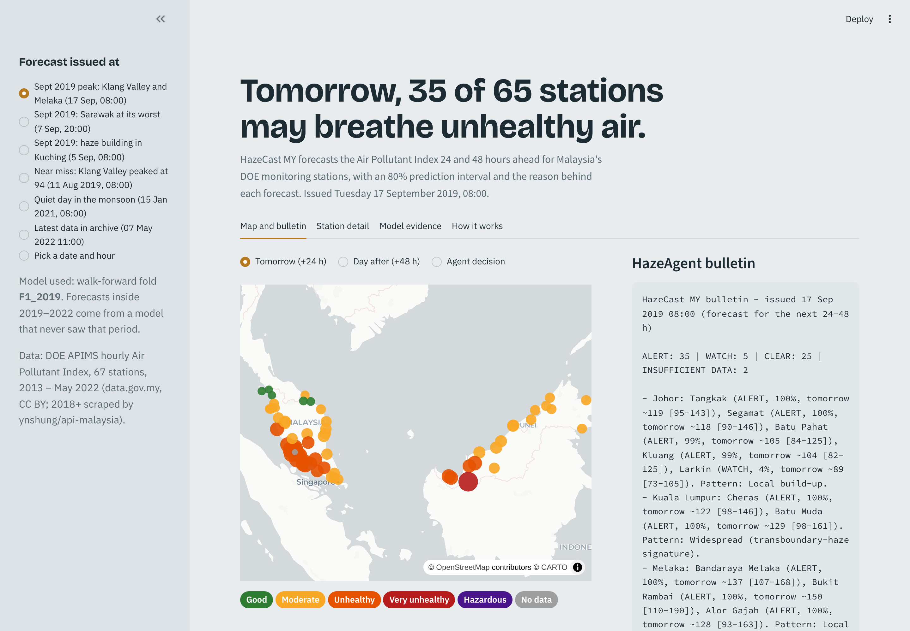
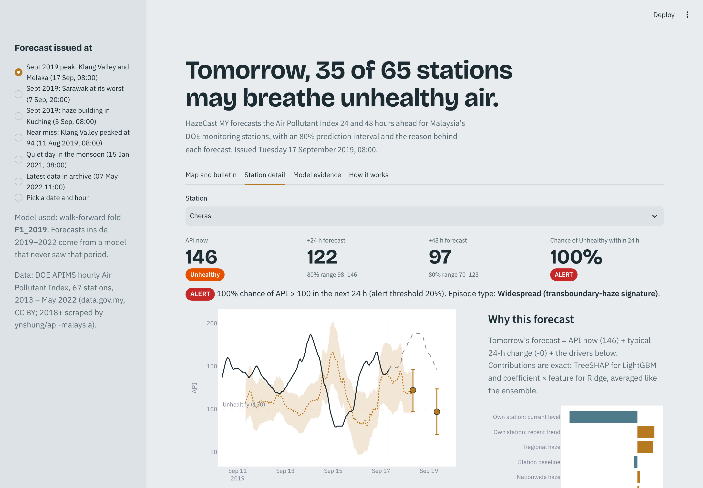
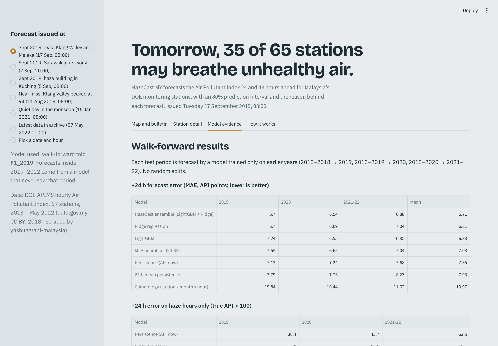

# HazeCast MY: a 24/48-hour haze early warning for Malaysia

**Neural Storm 2026 · Track 2: Green Planet · Problem statement GP-01 (Air Quality Monitoring & Source Attribution)**
**Team:** HazeCast (solo): Shermaine Yap Shi Min, Asia Pacific University of Technology & Innovation, Malaysia
**Live demo:** https://hazecast-my.streamlit.app · **Code:** this repository (MIT licence)



---

## The problem

Every haze season, Malaysians learn the air is unhealthy when the API reading has *already* turned red. APIMS, the Department of Environment's public index, shows the last hour's Air Pollutant Index. It gives no forecast and no reason for the number.

- In September 2019, 48 of Malaysia's monitoring stations were Unhealthy (API > 100) at the same time (DOE APIMS data in this repo). Schools across several states closed.
- The problem keeps coming back: on 3 Sept 2026, 20 areas recorded unhealthy to hazardous readings ([The Star](https://www.thestar.com.my/news/nation/2026/09/03/20-areas-in-malaysia-record-unhealthy-to-hazardous-api-readings-as-of-9am)). On 27 Aug 2026, four areas in Kuching went unhealthy ([Malay Mail](https://www.malaymail.com/news/malaysia/2026/08/27/haze-four-areas-in-sarawak-capital-record-unhealthy-api-readings/232794)).

Decisions like "cancel tomorrow's outdoor sports day" or "hand out masks to delivery riders" need a day of warning, not an hour.

**Who it is for:** state education and health officers, school heads, employers of outdoor workers, and anyone with asthma.

## The solution

For each of 67 DOE stations, HazeCast MY gives:

1. **A forecast of the API 24 h and 48 h ahead**, from an ensemble of LightGBM and Ridge regression.
2. **The chance of Unhealthy air (API > 100) within 24 h**, from a calibrated LightGBM classifier.
3. **An 80% prediction range**, from conformal intervals that widen with recent volatility and with the forecast level.
4. **The reason behind the forecast**, from exact SHAP-style contributions grouped into plain-language drivers: the station's own level and trend, neighbouring stations, regional haze, nationwide haze, and season.
5. **A decision from HazeAgent: ALERT, WATCH, CLEAR or INSUFFICIENT DATA.** The agent declines to forecast when more than half of the last 24 h is missing. It labels each episode as *widespread (transboundary-haze signature)* or *local build-up*, and writes a state-by-state bulletin.

The app replays any hour from 2014 to May 2022. Every forecast shown for 2019–2022 comes from a model that **never saw that period** (walk-forward). Built-in scenarios include the September 2019 peak, Sarawak at its worst, a quiet monsoon day, and an honest **near miss**.

| Map and bulletin | Station detail and "why" | Model evidence |
|---|---|---|
|  |  |  |

## Results (walk-forward, no random splits)

Training and testing are split by time:

| Test period | Trained on | Calibration (last 15% of the training window) |
|---|---|---|
| 2019 (incl. the severe September haze) | 2013–2018 | May–Dec 2018 |
| 2020 | 2013–2019 | Mar–Dec 2019 |
| Jan 2021 – May 2022 | 2013–2020 | Feb–Dec 2020 |

The test set covers 1.9 million station-hours. Hyper-parameters, ensemble weights (0.5/0.5), the interval formula and the alert threshold were all fixed **before** looking at test data.

### 1. API forecast error, MAE in API points (lower is better)

| Model | +24 h, 2019 | +24 h, 2020 | +24 h, 2021–22 | **+24 h mean** | **+48 h mean** |
|---|---|---|---|---|---|
| **HazeCast ensemble (LightGBM + Ridge)** | **6.70** | **6.54** | 6.88 | **6.70** | 8.35 |
| Ridge regression | 6.70 | 6.69 | 7.04 | 6.81 | **8.33** |
| LightGBM | 7.24 | 6.55 | **6.85** | 6.88 | 8.79 |
| MLP neural net (64-32) | 7.55 | 6.65 | 7.04 | 7.08 | – |
| Persistence (API now) | 7.13 | 7.24 | 7.68 | 7.35 | 9.14 |
| 24-h mean persistence | 7.79 | 7.73 | 8.27 | 7.93 | 9.25 |
| Climatology (station × month × hour) | 19.84 | 10.44 | 11.62 | 13.96 | 13.96 |

**Skill vs persistence:** 8.8% lower error at +24 h and 8.7% lower at +48 h, averaged over the three test periods. The ensemble is the best model, or within 0.03 of the best, in every period.

Why an ensemble? LightGBM is strongest on ordinary days. It cannot extrapolate to record haze levels, though: in 2019 it was worse than persistence. Ridge extrapolates linearly. Averaging the two is the most robust option across all three periods.

Every learned model predicts the *change* from the current reading, not the level. Trees cannot extrapolate levels, but they can extrapolate changes.

### 2. "Unhealthy within the next 24 h" alerts

| Test period | Positives (station-hours) | PR-AUC, **HazeCast classifier** | PR-AUC, persistence (API now > 100) | PR-AUC, rule (API now ≥ 80) | Calibration error (ECE) |
|---|---|---|---|---|---|
| 2019 | 17,665 | **0.841** | 0.673 | 0.469 | 0.005 |
| 2020 | 366 | **0.225** | 0.177 | 0.032 | 0.001 |
| 2021–22 | 1,645 | **0.362** | 0.252 | 0.067 | 0.002 |

PR-AUC measures how well each method ranks risky station-hours across every possible threshold. The classifier wins in every period, and its probabilities are well calibrated (low ECE, reliability plot in the app).

At HazeAgent's fixed 20% threshold, F1 is 0.78, 0.24 and 0.29 for the three periods. Plain persistence is a tough baseline here (F1 0.80, 0.33, 0.42), because most "Unhealthy tomorrow" hours sit inside episodes that are already under way.

**Haze onsets** are the first hour a station crosses 100 after two clear days. On these, with the classifier's alert budget matched to the ≥ 80 rule, it warned of:

| Test period | HazeCast classifier | Rule (API ≥ 80) |
|---|---|---|
| 2019 | 159 / 169 onsets, median warning 19 h | 166 / 169, 17.5 h |
| 2020 | 9 / 12, 9 h | 9 / 12, 3 h |
| 2021–22 | 34 / 45, 9.5 h | 37 / 45, 13 h |

HazeCast gives a longer warning in 2019 and 2020. The simple rule detects slightly more onsets. We report both.

### 3. Prediction-range coverage (target 80%)

| | 2019 | 2020 | 2021–22 | Mean |
|---|---|---|---|---|
| +24 h coverage | 82.9% | 73.6% | 79.7% | **78.7%** |
| +48 h coverage | 82.4% | 75.6% | 78.7% | **78.9%** |
| +24 h coverage when the true API > 100 | 30% | 0% | 7% | – |

Ranges are well calibrated overall, but **too narrow during haze**. The calibration windows contain very few haze forecasts (only one in the window before 2021). When the *forecast* exceeds 100, volatility scaling raised coverage from 5–16% (fixed-width intervals) to 46–48% in 2019 and 60–75% in 2021–22. 2020 had only one such forecast. That is still below target, and the app says so.

### 4. Speed

Forecasting all 67 stations for one hour, including feature building, ensemble, intervals, alert probabilities and explanations, takes **0.79 s** on a 2-core CPU. Full training and evaluation over the three folds takes 15 minutes.

### 5. What drives the forecast

Measured as mean |contribution| on the 2021–22 test set, the biggest drivers of the +24 h ensemble are:

1. The current reading
2. The 24-hour change at the station
3. The 24-hour change in the regional mean
4. Readings 72 hours ago
5. The 24-hour max
6. The nationwide median

During widespread haze, the neighbour, regional and national drivers take over. HazeAgent uses this to label an episode as transboundary or local.

## How it works

```
DOE APIMS hourly API (67 stations, 2013 – May 2022, 3.8 M station-hours)
   │
   ├─ features (36 per station-hour, all known at issue time):
   │    own lags 1 h–7 d, 3/6/24 h changes, rolling mean/max/std, missing-data share,
   │    3 nearest stations (mean, max, trend), region mean + trend,
   │    nationwide median / p90 / share of stations > 70 and > 100,
   │    hour, weekday, month (sin/cos), SW-monsoon flag, station id
   │
   ├─ +24 h and +48 h change models: LightGBM + Ridge  ──► ensemble forecast
   │      └─ normalised split-conformal 80% ranges (scale = 3 + std_24 + 0.2·forecast)
   ├─ Unhealthy-within-24 h classifier: LightGBM (calibrated probabilities)
   ├─ explanations: TreeSHAP (LightGBM) + coefficient × feature (Ridge), grouped into drivers
   └─ HazeAgent: ALERT / WATCH / CLEAR / INSUFFICIENT DATA + episode type + bulletin
```

- **Alert threshold:** p ≥ 0.2, from a stated cost ratio (missing an Unhealthy day costs 4× a false alarm, so the threshold is 1/(1+4)). It is not tuned on test data.
- **Leakage checks:** unit tests confirm that changing future readings never changes a feature, and that targets look strictly forward.

### Repository layout

| Path | What it is |
|---|---|
| `hazecast/data.py` | Loads and cleans the APIMS archive onto an hourly grid |
| `hazecast/features.py` | 36 leakage-free features and the forecast targets |
| `hazecast/conformal.py` | Normalised split-conformal intervals |
| `hazecast/evaluate.py` | MAE, PR-AUC, ECE, reliability, onset lead time |
| `hazecast/forecast.py` | Out-of-sample forecaster: picks the right fold's models, ensemble, explanations |
| `hazecast/agent.py` | HazeAgent decisions and bulletin |
| `train.py` | Walk-forward training and evaluation; writes `artifacts/` |
| `app.py` | Streamlit app |
| `tests/` | Unit tests (pytest) |
| `artifacts/metrics.json` | Every number in this README |

## Setup and run

```bash
git clone https://github.com/ShermaineYap/neural-storm.git
cd neural-storm
python -m venv .venv && source .venv/bin/activate      # Windows: .venv\Scripts\activate
pip install -r requirements.txt

streamlit run app.py          # uses the trained models in artifacts/
python train.py               # optional: retrain + re-evaluate all folds (~15 min, 2 CPU cores)
python train.py --quick       # 3-minute smoke test on a subsample
pip install pytest && pytest  # 11 unit tests
```

Tested with Python 3.13, pandas 3.0, scikit-learn 1.9, LightGBM 4.7 and Streamlit 1.66.

## Data

- **Source:** DOE Malaysia APIMS hourly API, via [ynshung/api-malaysia](https://github.com/ynshung/api-malaysia).
  - 2005–2017 comes from [data.gov.my](https://data.gov.my) (CC BY / Open Definition 2.1).
  - 2018 onwards was scraped from the public APIMS table.
- **Range used:** 2013 onwards, where readings are hourly. The archive ends on 7 May 2022.
- **Station coordinates:** approximate town centres, used only for the map and for choosing neighbours.

## Limitations and responsible use

- **Composite index only.** The archive holds the API, not individual pollutants (PM2.5, PM10, O₃, CO, NO₂, SO₂). "Source attribution" here means *which signals drive the forecast*: a station's own build-up versus a widespread, transboundary-style pattern. It is **not** chemical source apportionment.
- **No weather or fire data yet.** Wind, rain and MODIS/VIIRS hotspots over Sumatra and Kalimantan are the obvious next inputs. They are what would let the model see a haze episode coming *before* it reaches the first station.
- **Established haze.** During an episode that is already under way, the current reading is hard to beat (MAE on true API > 100 hours: persistence 36–63, HazeCast 44–65). HazeCast's edge is on ordinary and transition hours, and in ranking risk.
- **Intervals during haze** cover less than 80% (see above).
- **History, not a live feed.** The public archive ends in May 2022, so the app replays history. A live feed would need APIMS access.
- **Not an official product.** This is a research prototype. Always follow official DOE / APIMS advisories and Ministry of Health guidance. No personal data is used.

## AI development tools used

Built during the hackathon window with **Claude (Anthropic)** as an AI coding and research assistant. Claude was used for hackathon research, data-pipeline and model code, the Streamlit UI and README drafting. All numbers come from `train.py` runs on the data in this repository.

## Licence and credits

- **Code:** MIT (see `LICENSE`).
- **Data:** DOE Malaysia / data.gov.my (CC BY); archive and scraper by [ynshung](https://github.com/ynshung/api-malaysia).
- **Map tiles:** © OpenStreetMap contributors © CARTO.
